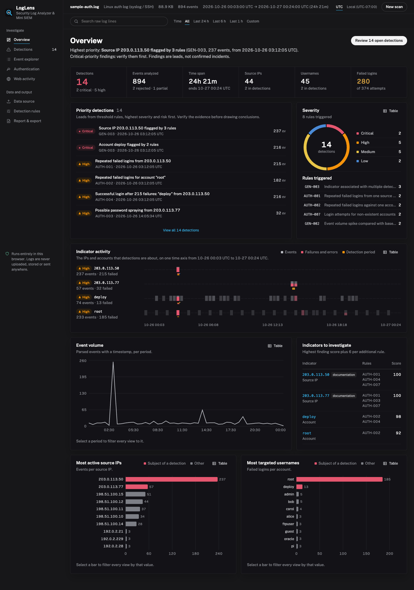
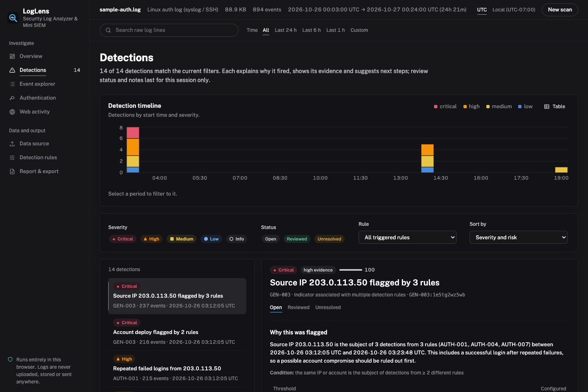
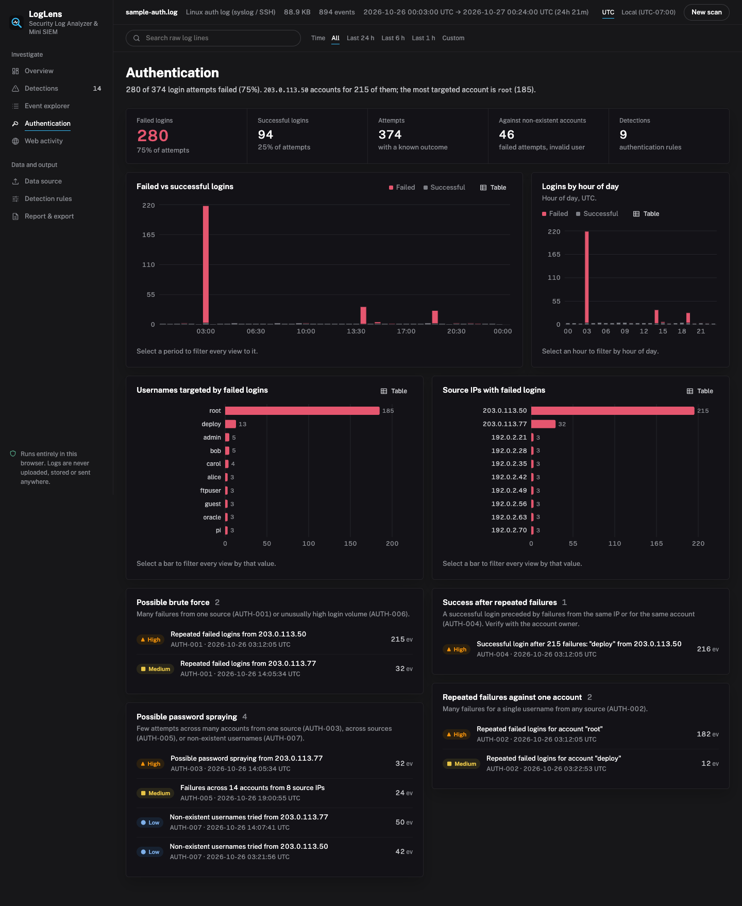
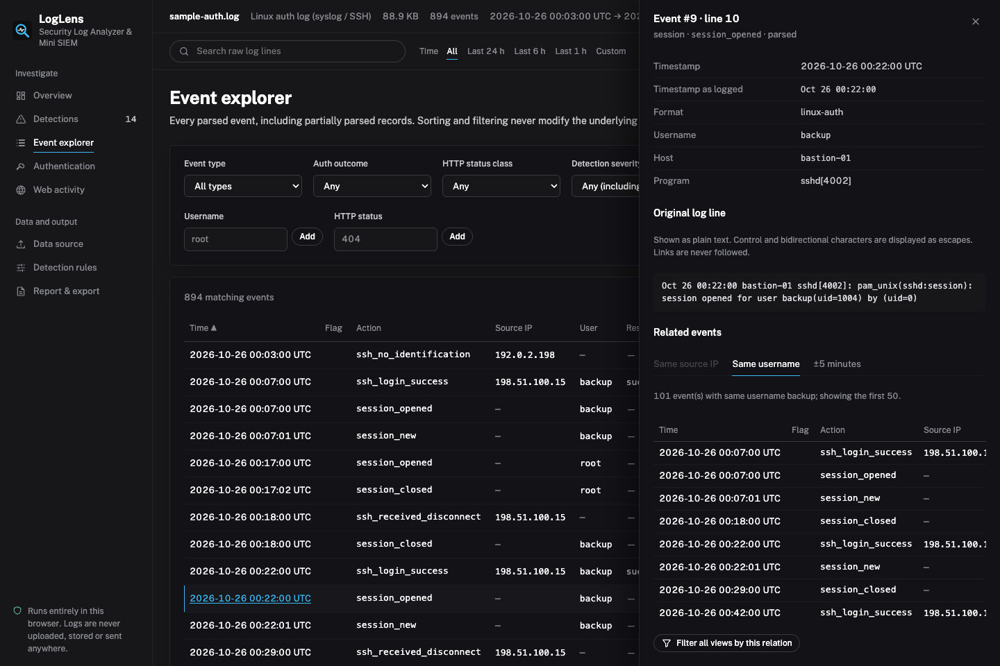
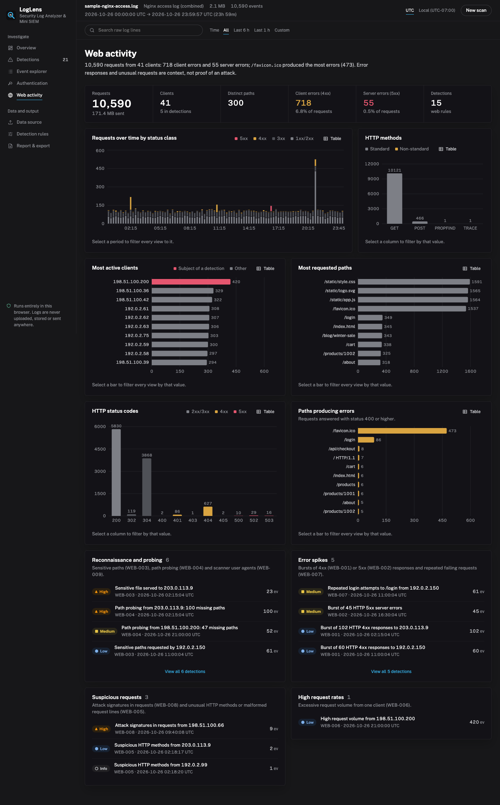
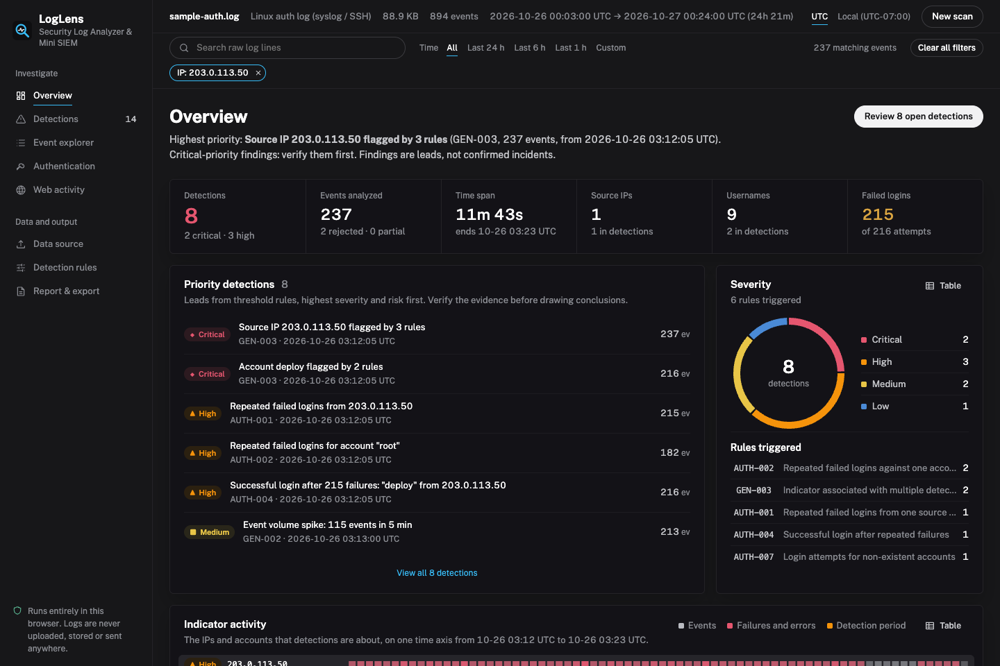
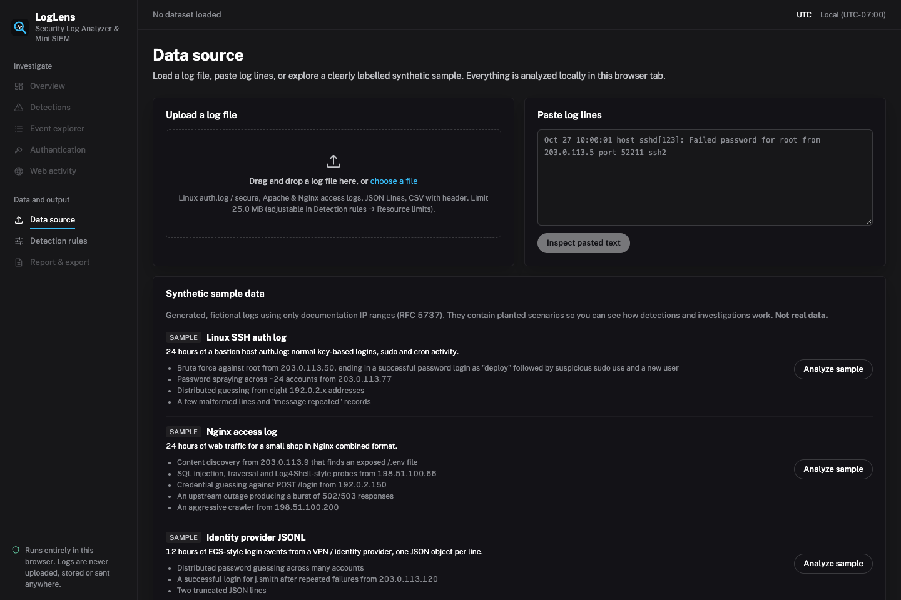
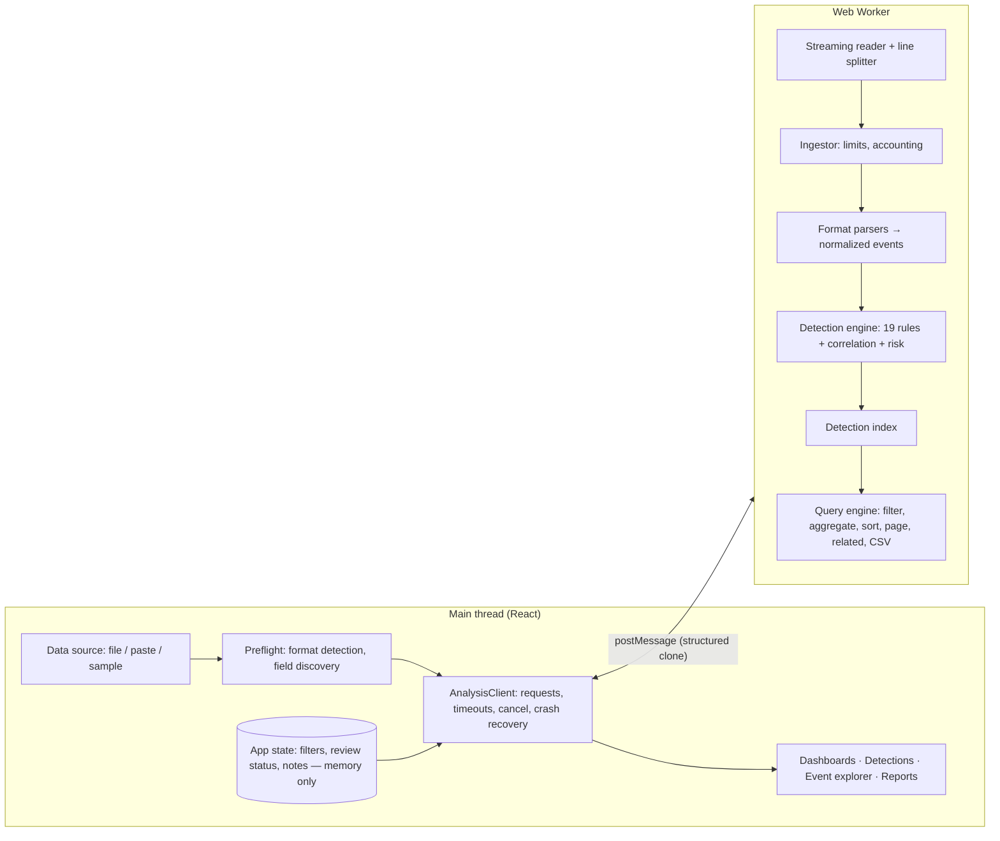

<div align="center">

# LogLens

**Security Log Analyzer & Mini SIEM**

Investigate authentication and web-server logs with explainable detections — entirely in your browser.




</div>

LogLens parses Linux auth logs, Apache/Nginx access logs, JSON Lines and CSV into a shared event model, runs 19 transparent threshold-based detection rules, and lets an analyst investigate the results through cross-filtered SOC dashboards, an event explorer and an alert workflow. There is no backend: files are streamed and analyzed in a Web Worker in the browser tab, and the production build forbids network connections with a Content-Security-Policy.

> LogLens produces **leads, not verdicts**. Every finding explains exactly which condition fired, shows the supporting events, and lists its limitations and likely false-positive causes.

## Contents

- [Features](#features)
- [Screenshots](#screenshots)
- [Supported formats](#supported-formats)
- [Example workflows](#example-workflows)
- [Example detections on the synthetic samples](#example-detections-on-the-synthetic-samples)
- [Architecture](#architecture)
- [Getting started](#getting-started)
- [Testing and quality checks](#testing-and-quality-checks)
- [Privacy and security](#privacy-and-security)
- [Detection limitations and false positives](#detection-limitations-and-false-positives)
- [Performance and limits](#performance-and-limits)
- [Deploying to GitHub Pages](#deploying-to-github-pages)
- [Project structure](#project-structure)
- [Future improvements](#future-improvements)

## Features

**Ingestion**

- File picker, drag-and-drop, pasted text, and four clearly labelled synthetic sample datasets.
- Format detection from a 64 KB sample, with confidence, candidates and a manual override when the result is ambiguous (Apache and Nginx share a format, so LogLens asks).
- Field mapping for CSV and JSONL, with suggestions from column names and example values (for example, a numeric `status` maps to HTTP status, a textual one to outcome).
- Every line is accounted for: parsed, partially parsed (with the reasons), rejected (with a bounded, escaped preview), skipped, or explicitly "not analyzed" after a limit. Duplicates are counted and kept; syslog `message repeated N times` lines are expanded.
- Timestamp normalization to UTC with strict validation: RFC 3339, CLF, RFC 2822, syslog (year assumed, Dec→Jan rollover detected), epoch s/ms/µs/ns. A configurable source offset applies to zone-less timestamps. The display zone (UTC or browser-local) is always shown.

**Detection and risk**

- 19 deterministic rules: 7 authentication, 9 web, 3 general (data quality, volume baseline, cross-rule correlation). See [docs/DETECTIONS.md](docs/DETECTIONS.md).
- Each detection carries: rule id and name, severity, evidence strength, a 0–100 priority score, the plain-language reason, the condition with configured values, thresholds and the measured value, matching event count, IPs and usernames, start/peak/end timestamps, supporting event references, investigation steps, limitations, false-positive causes and related MITRE ATT&CK techniques.
- Thresholds and windows are editable per rule; values are validated and clamped, and detections re-run without re-parsing. Rules that cannot run on a dataset say why ("No web requests with timestamps…").

**Investigation**

- Overview, authentication dashboard, web activity dashboard, detections view with timeline, and an event explorer. The overview states the highest-priority finding in its first line and leads with the detection count.
- _Indicator activity_: every IP and account that a detection is about, on one shared time axis, with failures and the detection periods marked, so the order of events is visible at a glance.
- One global filter state (time range, IP, user, event type, outcome, HTTP method/status/path, hour, severity, rule, review status, raw-text search) drives every chart, counter, alert list and table. Clicking a bar, column, donut segment or time bucket adds a filter; every chart's table view has the same filter buttons for keyboard users. Time presets (last 24 h / 6 h / 1 h) are relative to the last event in the data, not the clock.
- Alert workflow: evidence table, pivots by IP, username or a ±15-minute window, review status (open / reviewed / unresolved) and notes kept in memory for the session.
- Event detail in a side drawer (Escape closes it and returns focus to the row) with every parsed field, the original line (control and bidi characters made visible), linked detections, and related events by IP, username or time window.
- Each view has its own URL (`#/alerts`, `#/web`…), and `?sample=<id>` opens a bundled sample directly, for example `?sample=ssh-auth#/alerts`. Only the bundled samples can be opened this way; a URL can never load or reference log data.
- Every chart has a table view with the exact plotted values, a text summary for screen readers, and an empty state when the data lacks the needed fields.

**Reporting**

- JSON investigation report: application version, scan time, format and parsing statistics, time range, aggregated metrics, detections with evidence summaries and event references, rule configuration, review status and notes (optional), and assessment limitations. Raw log lines are excluded unless explicitly requested.
- CSV export of the filtered events with spreadsheet-formula neutralization.

## Screenshots

All screenshots show the production build analyzing the bundled synthetic samples.

| Detections and evidence                                                                                         | Authentication dashboard                                                                                 |
| --------------------------------------------------------------------------------------------------------------- | -------------------------------------------------------------------------------------------------------- |
|  |         |
| **Event explorer with event detail**                                                                            | **Web activity (Nginx sample)**                                                                          |
|      |  |
| **Cross-filtering by source IP**                                                                                | **Data source**                                                                                          |
|                                         |                                |

## Supported formats

| Format             | Examples                                                                    | Notes                                                                                                                                                                                        |
| ------------------ | --------------------------------------------------------------------------- | -------------------------------------------------------------------------------------------------------------------------------------------------------------------------------------------- |
| Linux auth logs    | `/var/log/auth.log`, `/var/log/secure`, `journalctl -o short` / `short-iso` | sshd (including `sshd-session`), PAM, sudo, su, systemd-logind, useradd/usermod. Failed `none` probes, `Invalid user` notices and duplicate PAM failures are not double-counted as attempts. |
| Apache access logs | Common and Combined Log Format, optional `%v:%p` vhost prefix               | Malformed request lines (for example TLS handshakes on a plain-HTTP port) are kept as partial records.                                                                                       |
| Nginx access logs  | Default `combined`, plus trailing fields such as `$http_x_forwarded_for`    | Same layout as Apache; trailing fields are preserved.                                                                                                                                        |
| JSON Lines         | `.jsonl`, `.ndjson`, ECS-style nested objects                               | Nested keys are flattened (`source.ip`). Non-object or truncated lines are rejected without echoing content.                                                                                 |
| CSV                | Header row required; `,` `;` tab `\|` delimiters, `sep=` directive          | RFC 4180 quoting, including quoted newlines.                                                                                                                                                 |
| Pasted text        | Any of the above                                                            | Same pipeline as files.                                                                                                                                                                      |

Mappable fields for CSV/JSONL: timestamp, event type, action, outcome, source IP, username, host, HTTP method, URL path, HTTP status, user agent, message, source severity.

Not supported (and rejected with a clear message): compressed archives, Windows `.evtx`, binary files.

## Example workflows

**Triage an SSH brute force**

1. Data source → **Analyze sample** on "Linux SSH auth log".
2. The overview's first line names the highest-priority finding: a critical correlation for `203.0.113.50`. Open it from _Priority detections_.
3. The detection explains it: AUTH-001 (215 failed logins), AUTH-004 (a successful password login as `deploy` after 215 failures) and AUTH-007 (non-existent usernames tried), all from that address.
4. Click the IP chip to pivot. Every dashboard and the event explorer now show only that source; the timeline narrows to 11 minutes.
5. Open the successful login event and switch _Related events_ to **±5 minutes** to see the `sudo curl … update.sh` and `useradd sysupdate` that followed.
6. Mark the detection **Reviewed**, add a note, and download the JSON report.

**Investigate web reconnaissance**

1. Analyze the "Nginx access log" sample and open **Web activity**.
2. _Reconnaissance and probing_ lists "Sensitive file served to 203.0.113.9": a `/.env` request returned **200** during a 100-path discovery run.
3. Click the `200` column in _HTTP status codes_ together with the IP filter to see exactly what that client received.

**Bring your own CSV**

1. Drop a CSV export (for example from a reverse proxy or SIEM).
2. Confirm the detected format and review the suggested field mapping (timestamp, source IP, method, path, status, user agent…).
3. Analyze. Rules that need fields you did not map are listed as "not evaluated" with the reason.

## Example detections on the synthetic samples

These are the actual results produced by the default rules on the bundled samples (verified by `tests/integration/samples.test.ts`).

**Linux SSH auth log** — 888 lines → 894 events (885 parsed, 1 partial, 2 rejected), 14 detections:

| Severity | Rule     | Detection                                                       | Events |
| -------- | -------- | --------------------------------------------------------------- | ------ |
| critical | GEN-003  | Source IP 203.0.113.50 flagged by 3 rules                       | 237    |
| critical | GEN-003  | Account deploy flagged by 2 rules                               | 216    |
| high     | AUTH-001 | Repeated failed logins from 203.0.113.50                        | 215    |
| high     | AUTH-002 | Repeated failed logins for account "root"                       | 182    |
| high     | AUTH-004 | Successful login after 215 failures: "deploy" from 203.0.113.50 | 216    |
| high     | AUTH-003 | Possible password spraying from 203.0.113.77                    | 32     |
| high     | GEN-003  | Source IP 203.0.113.77 flagged by 3 rules                       | 57     |
| medium   | GEN-002  | Event volume spike: 115 events in 5 min                         | 213    |
| medium   | AUTH-005 | Failures across 14 accounts from 8 source IPs                   | 24     |
| …        |          | 5 more (medium/low)                                             |        |

**Nginx access log** — 10,591 lines → 10,590 events, 21 detections, including:

| Severity | Rule    | Detection                                          | Events |
| -------- | ------- | -------------------------------------------------- | ------ |
| high     | WEB-008 | Attack signatures in requests from 198.51.100.66   | 9      |
| high     | WEB-003 | Sensitive file served to 203.0.113.9               | 23     |
| high     | WEB-004 | Path probing from 203.0.113.9: 100 missing paths   | 100    |
| high     | GEN-003 | Source IP 203.0.113.9 flagged by 5 rules           | 103    |
| medium   | WEB-007 | Repeated login attempts to /login from 192.0.2.150 | 61     |
| medium   | WEB-002 | Burst of 45 HTTP 5xx server errors                 | 45     |
| low      | WEB-006 | High request volume from 198.51.100.200            | 420    |
| low      | WEB-009 | Scanner user agent from 203.0.113.9: zgrab, Nikto  | 103    |

The same run also shows a realistic false positive: the aggressive crawler `198.51.100.200` triggers WEB-001, WEB-004 and WEB-006. GEN-003 still links those three detections, but rates the link medium rather than high, because 4xx bursts, path probing and high volume are overlapping views of the same crawl rather than independent kinds of signal.

**Identity provider JSONL**: the brute-forced login is high (`Successful login after 6 failures: "j.smith" from 203.0.113.120`). Four logins whose only link to earlier failures is the account name, with the failures coming from other addresses, are reported separately as low-confidence leads (`Login for "j.smith" after failures from other sources`), never as critical.

## Architecture



- **Parsing, normalization, detection, risk, analytics and reporting are framework-free TypeScript modules** in `src/features/`. They have no React or DOM dependencies and are unit-tested directly.
- **The worker owns the dataset.** The UI never holds all events. It asks the worker for filtered metrics, a page of events, a detection's evidence, or related events. One metrics query per filter change feeds every chart and counter, which keeps the views consistent.
- **Alert scope follows the events.** A detection is in scope when at least one of its supporting events matches the event filters. Severity, rule and review-status filters work the other way round: they constrain events to those that support a matching detection.
- **The normalized event model** (`src/types/events.ts`) keeps common fields (time, source IP, username, category, action) at the top level and source-specific semantics in typed `auth` and `http` sections. Authentication and web records are not forced into the same shape.
- **Determinism:** identical input and configuration produce identical detections, ids and ordering. Review status therefore survives a threshold change for findings that still exist.

## Getting started

Requirements: Node.js 20.19+ (tested with Node 26) and npm.

```bash
npm ci            # install exact locked dependencies
npm run dev       # start the dev server at http://localhost:5173
npm run build     # type-check and build the static site into dist/
npm run preview   # serve the production build (with its CSP) at http://localhost:4173
```

Then open the app, choose a sample or drop a log file, confirm the format, and click **Analyze locally**. To jump straight into a bundled sample, open for example `http://localhost:5173/?sample=ssh-auth#/alerts` (samples: `ssh-auth`, `nginx-access`, `jsonl-auth`, `csv-web`).

## Testing and quality checks

```bash
npm test               # all unit, integration and component tests (Vitest)
npm run coverage       # tests + V8 coverage (text summary + HTML in coverage/)
npm run lint           # ESLint (type-aware, React hooks, security guardrails), zero warnings allowed
npm run typecheck      # TypeScript strict mode for app, tests and config
npm run format:check   # Prettier
npm run check          # all of the above plus the production build
```

Test suites:

- `tests/unit/` covers every parser and its fixtures, timestamp and time-zone handling, IP validation, field mapping, ingestion limits and accounting, every detection rule including threshold boundaries and false-positive cases, risk scoring, correlation, analytics (filters, aggregates, paging, related events), report and CSV generation, the worker service and client (timeouts, cancellation, crashes, repeated scans), and source-hygiene security checks.
- `tests/integration/` runs end-to-end expectations for each synthetic sample.
- `tests/components/` covers the React app driven with Testing Library against an in-process worker: cross-filtering, the investigation workflow, XSS-like content, file validation, cancellation, worker failure and exports.

Coverage thresholds of 90% lines are enforced for `src/features/log-ingestion`, `src/features/detection` and `src/features/analytics`.

## Privacy and security

- Logs are processed locally in a Web Worker and never uploaded. There is no backend, analytics, remote font, CDN or threat-intelligence lookup.
- The production CSP sets `connect-src 'none'`, so the page cannot make network requests.
- Nothing is written to `localStorage`, `sessionStorage`, IndexedDB, Cache Storage or cookies. Reloading discards everything.
- Log content is only ever rendered as text, never as HTML or code. Invisible and bidirectional characters are shown as escapes.
- Exports: raw lines are excluded by default, CSV cells are formula-neutralized, JSON is HTML-safe, and file names are sanitized.

Details: [SECURITY.md](SECURITY.md) (threat model, controls, CSP, dependency review) and [PRIVACY.md](PRIVACY.md).

## Detection limitations and false positives

- **Thresholds, not proof.** A failed login, an HTTP error, a public IP or an odd user agent is not evidence of malicious activity on its own. Severity expresses review priority.
- **Only what the logs say.** Access logs show requests and status codes, not application behaviour. A matching injection signature shows intent in the request, not a successful exploit.
- **Shared addresses.** NAT gateways, proxies, VPNs, load balancers and CDNs can make many users look like one IP (and the reverse).
- **Correlation is by exact value.** GEN-003 links identical IPs or usernames only, and several rules can fire on the same underlying activity.
- **Baselines are local.** GEN-002 compares buckets with the median of the uploaded data only; short or irregular logs give weak baselines.
- **Signatures are evadable.** WEB-008 uses small, readable regular expressions over decoded text. Encoding tricks evade them and benign text can match them. User agents (WEB-009) are trivially spoofed.
- **Time matters.** Events without valid timestamps are excluded from windowed rules (reported per detection). Syslog has no year or zone; both are assumptions you can set and that the report records.
- **Common false positives:** users mistyping passwords, services with stale credentials, monitoring and crawlers, authorised scanners, deployments causing 5xx bursts, and WebDAV clients.

Each rule's full list is in [docs/DETECTIONS.md](docs/DETECTIONS.md) and in the detection detail view.

## Performance and limits

Measured with the analysis service in Node 26 on an Apple M2 (browser timings vary by device and engine):

| Input                  | Lines   | Events  | End-to-end analysis | Filtered metrics query | Search + sort + page |
| ---------------------- | ------- | ------- | ------------------- | ---------------------- | -------------------- |
| 25 MB Nginx access log | 127,092 | 127,080 | 0.85 s              | 5 ms                   | 20 ms                |
| 25 MB Linux auth log   | 254,856 | 256,578 | 2.3 s               | 15 ms                  | 32 ms                |

Default limits (adjustable under _Detection rules → Resource limits_): 25 MB input, 16,384-character lines, 500,000 events, 120 s timeout. LogLens does not support unlimited file sizes. Memory grows with the number of events, and every event keeps its original line for evidence. Scans can be cancelled at any time; cancellation terminates the worker and releases its memory.

## Deploying to GitHub Pages

The build uses a relative base (`./`), so the same `dist/` works at `https://<user>.github.io/<repository>/` without configuration. The worker is referenced relative to the bundle, which was verified by serving `dist/` from a `/LogLens/` sub-path.

1. Push the repository to GitHub with the default branch `main`.
2. In **Settings → Pages**, set **Source** to **GitHub Actions**.
3. Pushing to `main` runs `.github/workflows/deploy.yml`: lint, type-check, test, build, then publish `dist/` with `actions/deploy-pages`.
4. `.github/workflows/ci.yml` runs lint, type-check, format check, tests with coverage and the build on every push and pull request.

To build for a fixed absolute base instead, set `BASE_PATH`, for example `BASE_PATH=/LogLens/ npx vite build`.

GitHub Pages cannot send custom response headers. The CSP is therefore delivered as a `<meta>` tag, which cannot express `frame-ancestors`. If you need clickjacking protection, host the same `dist/` behind a server that sends the CSP and `frame-ancestors 'none'` as headers.

To add a status badge after the first CI run, use ``.

## Project structure

```
src/
  app/                 App, state reducer, contexts (state + filtered data)
  components/          layout, dashboard, charts, events, alerts, upload, settings, reports, common
  features/
    log-ingestion/     parsers/ (linux-auth, access log, jsonl, csv), normalization/ (timestamps, IPs, outcomes,
                       structured mapping), validation/ (limits, file checks, options), format detection,
                       streaming line splitter, ingestor, preflight
    detection/         engine/ (windows, context, runner), rules/ (auth, web, general, signatures, registry),
                       config/ (defaults + validation), risk/ (scoring, entities, posture)
    analytics/         event filtering, aggregation, sorting/paging/related events, detection index
    investigation/     filter translation and detection helpers used by the UI
    reporting/         JSON report builder, CSV export
    sample-data/       deterministic synthetic sample generators
  workers/             worker entry, analysis service, client, protocol, in-process fallback
  hooks/ types/ utils/ styles/
tests/
  unit/ integration/ components/ fixtures/ helpers/
docs/
  DETECTIONS.md        generated rule reference
  screenshots/
.github/workflows/     ci.yml, deploy.yml
```

## Future improvements

- More sources: Windows Security events exported to JSON, cloud audit logs (AWS CloudTrail, Azure AD sign-ins) with mapping presets, firewall logs, `journalctl -o json`.
- Optional gzip support via `DecompressionStream`, with a decompressed-size limit.
- User-defined rules (a declarative, sandboxed condition format) and saved rule profiles exported as JSON.
- Sessionization (linking sshd connect → auth → session → sudo by PID) for richer timelines.
- Opt-in, explicitly local persistence of settings, never of log data.
- Large-dataset UI: virtualized tables and a columnar in-worker store to reduce memory per event.
- An offline, user-supplied indicator list (for example a CSV of known-bad IPs) matched locally.

## License

[MIT](LICENSE). The sample data is synthetic and uses documentation IP ranges only.
